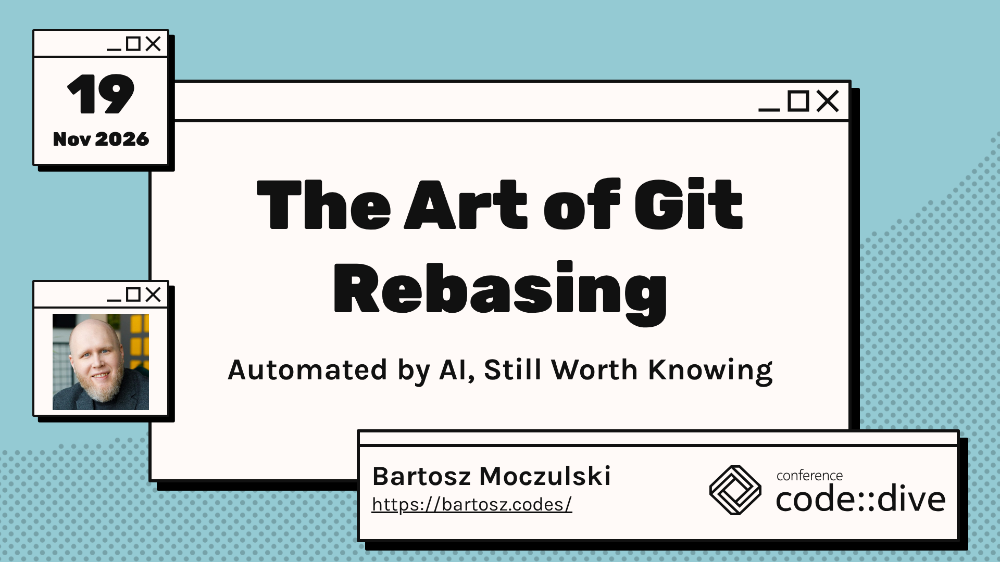

# The Art of Git Rebasing

[](https://bmoczulski.github.io/art-of-git-rebasing/)

Slides and the AI agent skill from the talk **"The Art of Git Rebasing: Automated by AI, Still Worth Knowing"**, code::dive, 19 November 2026.

Your pull request is a story: one commit, one job, in an order a reviewer can follow. The talk shows how to write that story with Git's own tools, and how to let an AI agent do it while you still check the result.

## Slides

**[Open the slides](https://bmoczulski.github.io/art-of-git-rebasing/)** in your browser, bonus slides included. Use the arrow keys or Space to move on, `F` for full screen. Or **[download the PDF](https://bmoczulski.github.io/art-of-git-rebasing/art-of-git-rebasing.pdf)**, one page per click.

## The skill: rebase-my-story

An agent skill that rewrites a Git branch into a clean, reviewable series of commits and proves the result is right:

- absorbs review fixes into the commits they fix
- splits, reorders, squashes and rewords commits, without opening an editor
- moves a branch, or a whole stack of branches, onto a new base, and resolves conflicts by intent
- proves the result: identical final tree after a reshape, `range-diff` with every commit accounted for, and every commit built and tested when that's affordable
- stays safe: a backup ref before rewriting, no commit dropped silently, no push unless you ask

More in the [skill's README](plugins/rebase-my-story/skills/rebase-my-story/README.md).

## Install the skill

### Claude Code, with updates

In Claude Code:

```
/plugin marketplace add bmoczulski/art-of-git-rebasing
/plugin install rebase-my-story@art-of-git-rebasing
```

Or from a shell:

```bash
claude plugin marketplace add bmoczulski/art-of-git-rebasing
claude plugin install rebase-my-story@art-of-git-rebasing
```

To get new versions automatically, turn on auto-update once: `/plugin` → Marketplaces → `art-of-git-rebasing` → Enable auto-update. Without it, update by hand with `claude plugin update rebase-my-story@art-of-git-rebasing`.

Then just ask, for example: *"clean up this branch for review"*, *"fold the review fixes into the commits they fix"* or *"rebase my stack onto main"*.

### Any other agent, or by hand

The skill is a plain directory in the [Agent Skills](https://agentskills.io/) format. Copy `plugins/rebase-my-story/skills/rebase-my-story/` into your agent's skills directory, for Claude Code `~/.claude/skills/rebase-my-story/`. Copied by hand, it doesn't update itself.

### Requirements

- bash 3.2 or newer, and Python 3
- Git 2.24 or newer; 2.40 or newer is recommended (`zdiff3`, `--update-refs`, `--force-if-includes`)

## License

- Slides and other presentation materials: custom license, free to study and to quote with credit, see [LICENSE.txt](LICENSE.txt).
- The skill (`plugins/rebase-my-story/`): MIT, see [its LICENSE](plugins/rebase-my-story/LICENSE).

## Contact

Bartosz Moczulski - moczulski@gmail.com  
https://bartosz.codes/
